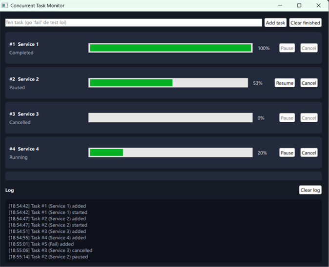
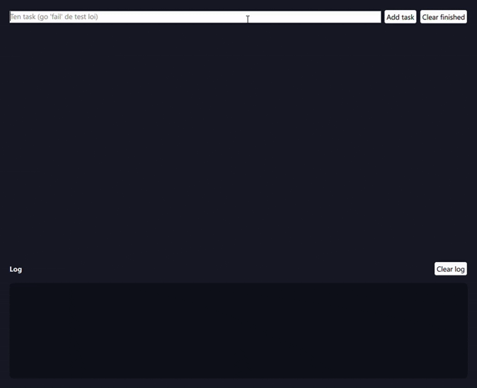

# Concurrent Task Monitor

[English](README.md) | **Tiếng Việt**

Ứng dụng desktop viết bằng **Qt 6, C++ và QML**. Ứng dụng chạy các
tác vụ nền trong một thread pool và hiển thị trạng thái, tiến độ và log
theo thời gian thực.

<p align="left">
  
  
  
  
  
</p>

<p align="left">
  
  
</p>

## Tính năng

- Thêm tác vụ theo tên. Tác vụ chạy trên luồng worker (`QThreadPool`, tối đa
  2 tác vụ chạy cùng lúc; các tác vụ còn lại chờ ở trạng thái **Pending**)
- Các trạng thái: Pending, Running, Paused, Completed, Failed, Cancelled
- Thanh tiến độ theo thời gian thực cho từng tác vụ
- **Pause / Resume** tác vụ đang chạy
- **Cancel** tác vụ (Pending, Running hoặc Paused)
- **Clear finished**: xóa các tác vụ đã kết thúc khỏi danh sách
- **Bảng log** theo thời gian thực (giờ, nội dung, lỗi màu đỏ, tối đa 500 dòng, có nút Clear log)
- Tắt máy an toàn: đóng ứng dụng sẽ hủy mọi tác vụ và chờ các luồng worker
  kết thúc
- Kiểm tra đầu vào: tên tác vụ rỗng bị từ chối
- Nhập tên `fail` để tạo tác vụ bị lỗi ở mức 50% (dùng để thử trường hợp lỗi)

## Yêu cầu

- Qt 6.5 trở lên (đã thử với Qt 6.11.2, MinGW 64-bit)
- CMake 3.21 trở lên
- Ninja
- Trình biên dịch C++17 (MinGW đi kèm bộ cài Qt)

## Build

Build Debug:

```powershell
cmake -S . -B build-debug -G Ninja -DCMAKE_PREFIX_PATH="<Qt path>" -DCMAKE_BUILD_TYPE=Debug
cmake --build build-debug
```

Build Release (mặc định nếu không chỉ định loại build):

```powershell
cmake -S . -B build-release -G Ninja -DCMAKE_PREFIX_PATH="<Qt path>" -DCMAKE_BUILD_TYPE=Release
cmake --build build-release
```

`<Qt path>` là thư mục bộ Qt của bạn, ví dụ `C:\Qt\6.11.2\mingw_64`.
Hãy chắc chắn các thư mục MinGW và Ninja của Qt đã nằm trong `PATH`.

## Script build (Windows)

Để khỏi gõ các lệnh ở trên, thư mục gốc có sẵn vài script batch nhỏ.
Chạy chúng từ PowerShell hoặc cmd, trong thư mục project
(ví dụ `.\m.bat`).

| Script | Công dụng |
|---|---|
| `b.bat` | Build lại toàn bộ: xóa `build`, `build-debug`, `build-release`, rồi build Debug và Release từ đầu. Hãy đóng ứng dụng trước. |
| `m.bat` | Build tăng dần: giữ lại thư mục build và chỉ build phần đã đổi. Tham số tùy chọn `debug` hoặc `release`, nếu bỏ trống sẽ build cả hai. |
| `t.bat` | Build tăng dần, rồi chạy test bằng CTest. Tham số tùy chọn `debug` hoặc `release`, nếu bỏ trống sẽ test cả hai. |
| `.build.debug.cmd` | Build Debug, rồi chạy ứng dụng ngay trong terminal (thấy được output ở console). |
| `.build.release.cmd` | Build Release, rồi mở ứng dụng trong cửa sổ riêng. |
| `.build.test.cmd` | Build Debug, chạy CTest, rồi chạy chương trình test để liệt kê từng test case. |

Các script giả định Qt nằm ở `C:\Qt\6.11.2\mingw_64` và các công cụ MinGW,
CMake, Ninja của bộ cài Qt nằm dưới `C:\Qt\Tools`. Nếu máy bạn để ở chỗ
khác, hãy sửa hai dòng `QT_DIR` và `PATH` ở đầu mỗi script.

## Chạy

```powershell
.\build-release\ConcurrentTaskMonitor.exe
```

Nếu cửa sổ không hiện ra, nhiều khả năng Windows không tìm thấy các DLL của
Qt. Hãy thêm các thư mục `bin` của Qt vào `PATH`, hoặc đóng gói DLL cạnh
file exe:

```powershell
windeployqt6 --release --qmldir . build-release\ConcurrentTaskMonitor.exe
```

## Test

Các test dùng Qt Test và chạy không cần giao diện. Cách dễ nhất là dùng
script, nó build những gì cần thiết rồi chạy test cho Debug và Release:

```powershell
.\t.bat
```

Hoặc tự chạy CTest:

```powershell
ctest --test-dir build-release --output-on-failure
```

Xem [docs/testing.md](docs/testing.md) để biết những gì được test và kết quả.

## Cấu trúc project

```
.
├── CMakeLists.txt
├── b.bat, m.bat, t.bat    build lại toàn bộ, build tăng dần, build và test
├── .build.*.cmd           script build và chạy (debug, release, test)
├── main.cpp               điểm vào của ứng dụng
├── Main.qml               giao diện
├── src/
│   ├── Task.h             dữ liệu tác vụ và enum trạng thái
│   ├── TaskRunnable.*     worker chạy trong thread pool
│   ├── TaskModel.*        model danh sách tác vụ dùng chung với QML
│   └── LogModel.*         model danh sách log dùng chung với QML
├── test/                  bộ test Qt Test cho TaskModel
└── docs/                  kiến trúc, test, hình ảnh
```

## Cách hoạt động

Các luồng worker không bao giờ đụng vào giao diện. Chúng chỉ phát signal;
Qt chuyển signal đó tới `TaskModel` trên luồng chính (queued connection),
rồi model cập nhật danh sách QML. Cancel và pause dùng các cờ atomic dùng
chung mà worker kiểm tra trong vòng lặp của nó.

Xem [docs/architecture.md](docs/architecture.md) để biết sơ đồ (viết bằng tiếng Anh).

## Hạn chế hiện tại

- Tác vụ chỉ là giả lập (100 bước, mỗi bước 50 ms), chưa làm việc thật
- Mới thử trên Windows với MinGW

## Hướng phát triển

- Cho phép chỉnh thời lượng tác vụ
- Độ ưu tiên cho tác vụ
- Các loại tác vụ thật thay cho bản giả lập

## Giấy phép

MIT, xem [LICENSE](LICENSE).
