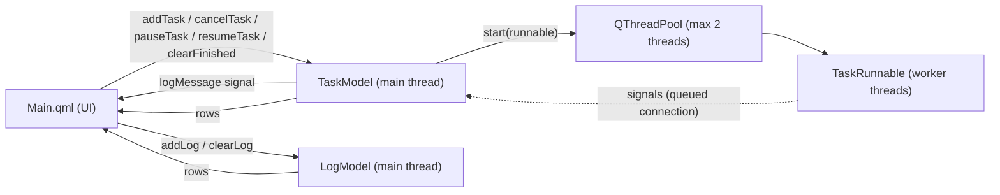
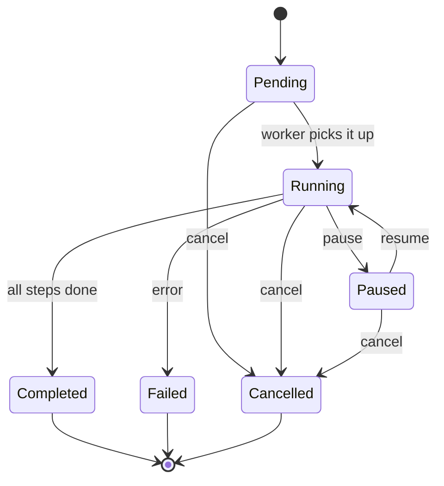

# Architecture

## Components

| Class | Thread | Role |
|---|---|---|
| `Task` | - | Plain data: id, name, status, progress, error, cancel/pause flags |
| `TaskRunnable` | pool thread | Does the work, reports with signals, checks flags |
| `TaskModel` | main | Owns the task list and the pool, updates state from signals |
| `LogModel` | main | Holds log lines (max 500) |
| `Main.qml` | main | Shows the models and calls the invokable functions |

## Task states

## Thread safety rules

1. Workers never read or write the model or the UI. They only emit signals.
2. Signals cross threads with a queued connection, so all slots of
   `TaskModel` run on the main thread.
3. The cancel and pause flags are `std::atomic<bool>` held by a
   `shared_ptr`, so both sides can use them safely.
4. Every slot looks up the task by id and returns if it is not found
   (the task may have been cleared while a signal was in flight).
5. A late `started` or `cancelled` signal is ignored for a task that is
   already Cancelled.
6. A paused worker still checks the cancel flag, so a paused task can be
   cancelled and shutdown never hangs.

## Shutdown

`~TaskModel()` sets the cancel flag of every task, then calls
`QThreadPool::waitForDone()`. Pending tasks stop immediately when
their turn comes, running and paused tasks stop at the next loop check.